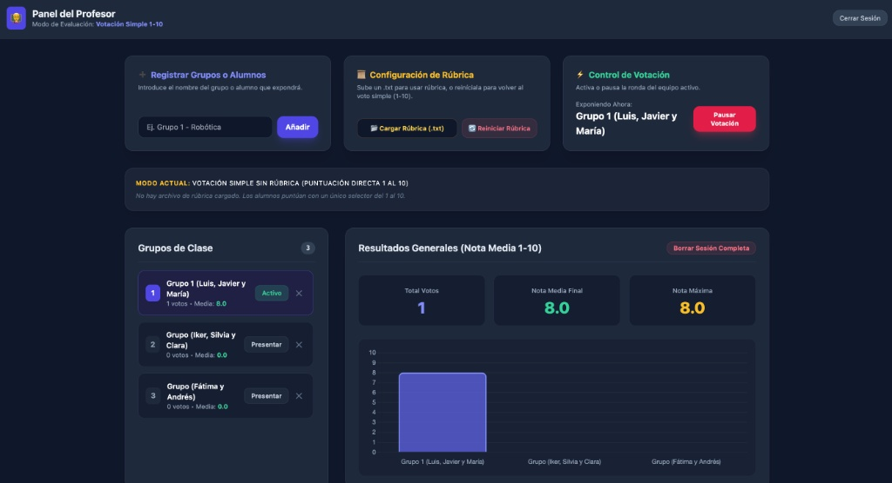
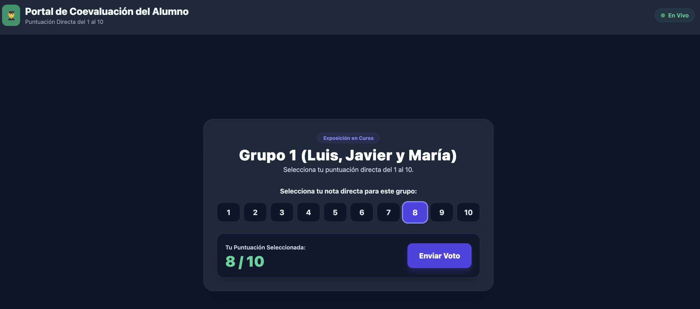
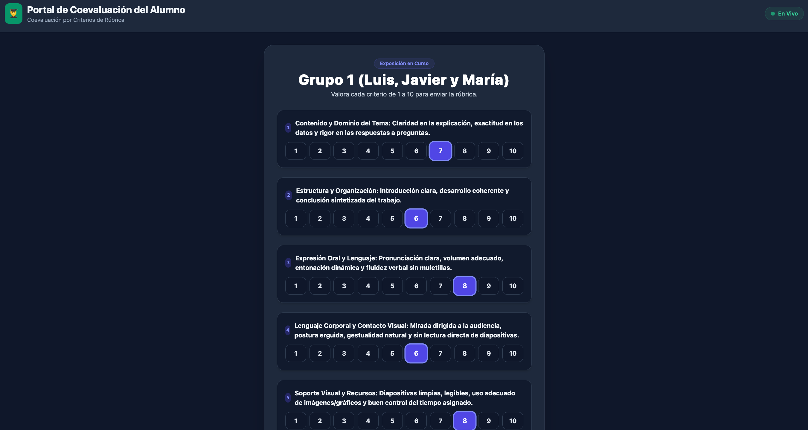

# Sistema de Coevaluación y Votación en Tiempo Real

Aplicación web ligera orientada a entornos educativos para realizar evaluaciones continuas entre compañeros durante presentaciones de trabajos en grupo. Diseñada para ser desplegada en el ordenador del profesor dentro de una red local (LAN/Wi-Fi de aula) sin depender de internet.

---

## 🎓 La Coevaluación en el Aula: Evaluación entre Iguales

La **coevaluación** es un proceso formativo en el que los propios alumnos valoran y retroalimentan el trabajo de sus compañeros de clase. A diferencia de la evaluación tradicional unidireccional centrada en la figura del profesor, la coevaluación convierte al estudiante en un agente activo del aprendizaje, fomentando el pensamiento crítico, la autorregulación, la empatía y la capacidad de juicio reflexivo. Al tener la responsabilidad de puntuar el desempeño de otros equipos, el alumnado interioriza los criterios de calidad académica, comprende los estándares de una buena exposición oral y se involucra de manera más proactiva durante las presentaciones de sus compañeros.

La aplicación ofrece **dos modos de funcionamiento automáticos**:
1. **Votación Simple 1 al 10 (Sin Rúbrica):** Calificación directa y rápida mediante botones numéricos grandes.
2. **Coevaluación por Rúbrica Personalizada:** Al cargar un archivo `.txt` con criterios, el sistema desglosa la evaluación y calcula automáticamente la nota media final.

---

## 🖼️ Capturas de Pantalla de la Interfaz

| Panel de Administración del Profesor (`/profesor`) |
| :---: |
|  |

| Portal de Coevaluación del Alumno (`/alumno`) |
| :---: |
|  |
| :---: |
|  |

---

## 🔑 Credenciales de Acceso

- **Panel de Administración (Profesor):**
  - **Ruta:** `http://<IP-DEL-PROFESOR>:3000/profesor`
  - **Usuario:** `admin`
  - **Contraseña:** `admin`

- **Portal de Votación (Alumnos):**
  - **Ruta:** `http://<IP-DEL-PROFESOR>:3000/alumno` (o `http://<IP-DEL-PROFESOR>:3000/` con redirección automática)
  - **Acceso libre sin contraseña**.

---

## 🛠️ Arquitectura y Estructura del Código

```text
votacion-aula/
├── package.json          # Dependencias (Express, Socket.io)
├── server.js              # Servidor Express, WebSockets y soporte híbrido
├── rubrica_ejemplo.txt    # Fichero de ejemplo de rúbrica de exposición oral
├── README.md              # Documentación oficial, coevaluación y guía de despliegue
└── public/
    ├── profesor.html      # Panel Admin: Gestión de grupos, carga/reinicio de rúbrica y gráfico
    └── alumno.html        # Portal Alumno: Interfaz adaptativa (voto directo 1-10 o criterios de rúbrica)
```

---

## 💻 Guía de Despliegue Multiplataforma

En el ordenador donde quieras que haga de servidor debes hacer lo siguiente. Elige tu sistema operativo y pruebalo. 

### 🐧 1. Linux Mint
```bash
sudo ufw allow 3000/tcp
npm install
npm start
```

### 🍎 2. macOS
```bash
ipconfig getifaddr en0
npm install
npm start
```

### 🪟 3. Windows (PowerShell Administrador)
```powershell
New-NetFirewallRule -DisplayName "Votacion Aula" -Direction Inbound -LocalPort 3000 -Protocol TCP -Action Allow
npm install
npm start
```
